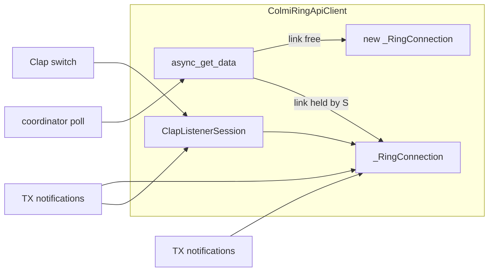

# Standalone Clap Detection (ring camera mode, `02 04` / `02 06`)

Goal: a second switch, independent of `Motion Stream`, that puts the ring in its
on-device camera/clap mode and turns the ring's own report into the `Clap` event.

Requested as: *"Send 0204 when it is toggled on, and 0206 when it is toggled off."*

**Status: built, on model B.** §2, §5 and §6 are implemented; §7 is done; the open
questions in §8 are answered except the two that need long-field observation.

---

## 1. What we now know (was hypothesis, now measured)

Evidence: the ATC RF03 writer, ring not streaming, one write then two manual claps.

```
13:33:17  Send CMD: 02040000000000000000000000000006      <- camera mode ON
13:33:59  Got Settings bytes: 02020000000000000000000000004   <- after a clap
13:36:07  Got Settings bytes: 02020000000000000000000000004   <- after a clap
```

| Fact | Consequence |
| --- | --- |
| `02 04` starts camera mode **without** `A1 04 04` | the clap detector does not need the RAW stream, so it can be its own switch |
| A clap pushes exactly one notification, unsolicited | HA can only see it **while it holds the ring's single GATT link** |
| The report is `02 02 00…00` with checksum `04` | our decoder must accept subtype `2` (see §2) |
| Nothing arrived right after the `02 04` write | the ring does **not** echo the enable, so nothing needs muting at session start — `MOTION_STARTUP_MUTE_S` existed only for the echo the RAW stream produced, and retires with §6 |
| Camera mode is remembered after disconnect (already noted in `_motion_stream` teardown) | a switch that only writes is a *setting*, not a *detector* (see §4 A) |
| RAW mode and camera mode both read one accelerometer | the two switches are mutually exclusive in practice |

## 2. Codec fix (required, independent of everything else)

`colmi_codec/motion.py`:

```python
GESTURE_REPORT_TYPES = frozenset({4, 5, 7})   # a guess, and wrong
GESTURE_REPORT_TYPES = frozenset({2})         # measured: 02 02 … 04
```

Notes:
- `4` in that set was our own enable sub-command, which is *why*
  `MOTION_STARTUP_MUTE_S` and `_is_gesture_enable_echo()` exist. Both were
  **deleted** rather than kept as belt-and-braces: with the set narrowed to `{2}`
  they guard a packet that is no longer treated as a report at all, and the RAW
  session no longer writes `02 04` (§6), so there is no echo to swallow anywhere.
  A mute that can never fire is a lie about the wire.
- The module docstring's "unverified on our R02" paragraph is now partly
  answered and should say so, citing the frame above. ✅
- The frame is a well formed packet: `sum(0x02, 0x02) & 255 == 0x04`, matching
  the trailing byte, so it is a real report body of zeros, not a malformed frame.

## 3. The load-bearing problem: notifications need a live link

A BLE notification only reaches a central that is connected at that moment. The
web tool received the claps because its page held the GATT connection for
minutes. So "write `02 04` and disconnect" arms a detector whose output nobody
is listening to.

The ring's one link is already claimed by, in priority order: a poll, a button
press, or the RAW motion stream. Anything holding the link **stops all polling**
— `coordinator._async_update_data` returns cached data while
`motion.holds_link` (`is_streaming or is_listening`) — which is exactly the cost
that has to be paid deliberately, not discovered later. The clap listener pays it
in full, which is what the auto-off in §8.2 exists to bound.

## 4. Connection models

**Decided: B.** C remains the right upgrade if multiplexed polls are ever wanted,
and B leaves it a clean path: the session, the `holds_link` gate and the state
listeners are all shaped so only the poll path changes.

### A. Write-only ("exactly as asked")  — rejected
Toggle on → connect, `02 04`, disconnect. Toggle off → connect, `02 06`.

- Cheap: one write, no held link, polling untouched, no battery surprise.
- **No `Clap` events.** The frame is dropped on the floor at clap time.
- Only honest as "ring camera mode", and it would look like a broken feature to
  anyone who expects the `Clap` event to fire.

### B. Dedicated listener, polls frozen  *(simplest that works)* — **built**
A `ClapListenerSession`: connect → listen on `0x02` → `02 04` → hold, no RAW
mode. Reconnect on drop. No silence watchdog (silence is the normal state; the
existing `MOTION_STREAM_SILENCE_TIMEOUT_S = 30` would kill it within half a
minute). On teardown: `02 06`, because the ring remembers it and would keep
burning battery.

- `Clap` events work, and work fast.
- **Polling stops indefinitely**: heart rate, battery, steps and backfill freeze
  for as long as the switch is on. That is a regression in the integration's
  main job, so it needs a visible auto-off (reuse `motion_stream_timeout`
  semantics or its own option) and a README warning.

### C. Listener + polls multiplexed over the held link  *(not taken — still viable later)*
Same session as B, but polls stop *skipping* and instead run on the connection
the session already owns.



Why it is tractable rather than a rewrite:
- `_RingConnection` **already** serves one-shot commands (`_handlers` /
  `_queues`) and open-ended listeners (`add_listener`) on the same link at the
  same time; `_motion_stream` proves it.
- `_handle_tx` dispatches to listeners *and* queues, so a `02 02` still reaches
  the gesture listener while an HR log read is in flight.
- Needs: a per-connection command mutex so two commands cannot interleave;
  extracting the body of `async_get_data` into `_async_read_data(conn, ...)` so
  both paths share it; a coordinator gate that reads "is the held link
  multiplexable" instead of "is the stream streaming"; and refreshing the
  session on stop so frozen sensors revive.
- Buttons can later drop their `_assert_ring_free` refusal the same way.
- Cost: a permanent connection (some battery, ring stops advertising) but data
  keeps flowing.

### D. Periodic short listen windows
Connect for N seconds every M, hope the ring flushes queued claps on connect.
Depends on unproven queueing behaviour; would report claps late or never.
Not recommended, listed only because it is the cheap-sounding option someone
reaches for.

## 5. Entities and ownership ✅

- New `ColmiRingClapDetectionSwitch` in `switch.py`, mirroring
  `ColmiRingMotionStreamSwitch`: `_attr_name = "Clap Detection"`,
  `mdi:hand-clap`, unique-id suffix `colmi_ring_clap_detection`, no
  `translation_key`, `is_on` reads real session state via a state listener, so
  the switch cannot lie when the link drops or the session ends.
- **Setup gate changes.** Both platforms currently require
  `entry.options.get(CONF_MOTION_ENABLED)`. Clap detection needs no motion
  option, so the switch is created unconditionally, and `event.py` creates the
  `Clap` event entity when *either* feature is available — otherwise the event
  entity disappears for users who only want claps.
- **Ownership: keep `MotionManager` as the single link owner.** It already has
  the session field, retry loop hand-off, `_publish()`, `add_event_listener`,
  `_set_streaming` state listeners, `async_shutdown`, and the coordinator's
  trust. Added `async_start_claps()` / `async_stop_claps()`, an `is_listening`
  flag with its own `_set_listening` listeners, and the `holds_link` property the
  coordinator now consults instead of `is_streaming`. Duplicating that machinery
  in a sibling manager would double the places the single-link rule lives.
- Reuse `GestureDetector.on_device_gesture()` for the event payload so the
  `Clap` event keeps the same `gesture`/`source` shape, and add a short dedupe
  window for ring reports (`on_device_gesture()` records a fire time but does
  not *check* one, so a burst of reports would fire N times). Done as
  `CLAP_REPORT_COOLDOWN_S = 0.8`, checked in `MotionManager._on_clap_packet`,
  which drops a repeat at DEBUG rather than silently.

## 6. Remove the old entanglement ✅

The RAW session must stop touching camera mode now that they are separate modes:

- `api._motion_stream`: drop `add_listener(CMD_CAMERA_GESTURE, …)` and the
  teardown `set_camera_gesture(False)`. The session listens on `CMD_RAW_MODE`
  only; `set_camera_gesture` is now called solely by `_clap_session`, which
  enables on open and disables best-effort on every exit path.
- `MotionManager`: drop `_async_enable_ring_gesture`, `_async_check_ring_gesture`,
  `_RING_GESTURE_ACK_S`, `_asked_ring_gesture`, `_ring_gesture_packets` and its
  `_on_packet` counting — that machinery existed to answer a question your web
  capture already answered. All gone. In their place `_run_claps` reports the
  *reason* a clap session ended, since for this feature the silence is the
  finding.
- `const.ENABLE_RING_CAMERA_GESTURE`, `MOTION_STARTUP_MUTE_S` and
  `_is_gesture_enable_echo()` are deleted outright, not just re-documented.
- **Mutual exclusion between the switches.** ✅ Done as *refuse*: turning one on
  while the other runs raises `HomeAssistantError` naming the switch to turn off
  first — `CLAP_BUSY_MESSAGE` sits beside the existing `STREAM_BUSY_MESSAGE`, and
  `ColmiRingEntity._assert_ring_free` now names whichever session holds the link.
  Auto-stopping was rejected: an automation turning on claps would silently end a
  gesture session the user is watching.

## 7. Docs to rewrite from hypothesis to fact ✅

- `README.md` → the two switches are now documented side by side, each with what
  it holds and what it costs, and *If the `Clap` event never fires* states the
  exclusivity as fact instead of hedging. The troubleshooting lines match the two
  strings `MotionManager._run_claps` actually logs ("could not be opened", and
  the `unarmed` line about a ring that never accepted `02 04`) rather than the
  retired stream-based WARNING.
- `plans/motion-gestures-plan.md`: the two settled assumption rows moved out of
  *Still unproven* into a measured-answer table; the risk rows that named
  `ENABLE_RING_CAMERA_GESTURE`, `_async_check_ring_gesture` and
  `_RING_GESTURE_ACK_S` now describe the switch and the `unarmed` reason; the
  Phase 2 text no longer claims the stream session listens for gestures; the data
  flow diagram shows two listeners and the `holds_link` gate.
- `_accel_probe.py` keeps its twice-arming test (it is how anyone reproduces
  this), and its verdict lines now say **camera mode CONFIRMED** and name the
  exclusivity as the reason the two switches refuse each other.
  `scripts/_gesture_report_check.py` was updated to the new verdict wording and
  still passes 8/8 — it asserts on those strings, so prose and test move together.

## 8. Open questions

1. **Connection model** — B, C, or the literal-but-silent A. (§4) → **B.**
2. If B: auto-off default for the clap listener, or never? → **`CONF_CLAP_TIMEOUT`
   minutes, default 120, `0` meaning "leave it on".** Deliberately its own option
   rather than sharing `motion_stream_timeout`, because the two sessions cost
   different things. It is *not* behind `CONF_MOTION_ENABLED` in the options flow,
   since the clap switch exists whether or not gesture streaming is enabled.
   Unlike the stream timer, it is **not** rearmed by activity: a rearm would let
   someone clapping every few minutes hold the ring's link, and therefore its
   data, indefinitely.
3. Switch conflict: refuse with an error, or auto-stop the other switch? (§6) →
   **Refuse**, with a message naming the switch to turn off.
4. Battery honesty: does `02 04` while connected cost measurably more than an
   idle link? Unknown; worth one observation before promising 24/7 in the README.
   The README currently promises no such thing, and the auto-off exists to bound
   the guess.
5. Does camera mode disturb the ring's own HR logging? Unknown — but it is
   currently unobservable, because on model B there is no HR logging to disturb
   while the switch is on. It becomes a question again only if model C lands.
6. New, from building it: a firmware that *accepts* the `02 04` write and then
   reports nothing is indistinguishable from one with no detector, because the
   write is fire-and-forget with no reply to await. `unarmed` therefore only means
   "the write itself failed", and the README says exactly that rather than
   claiming we can detect an unimplemented feature.
