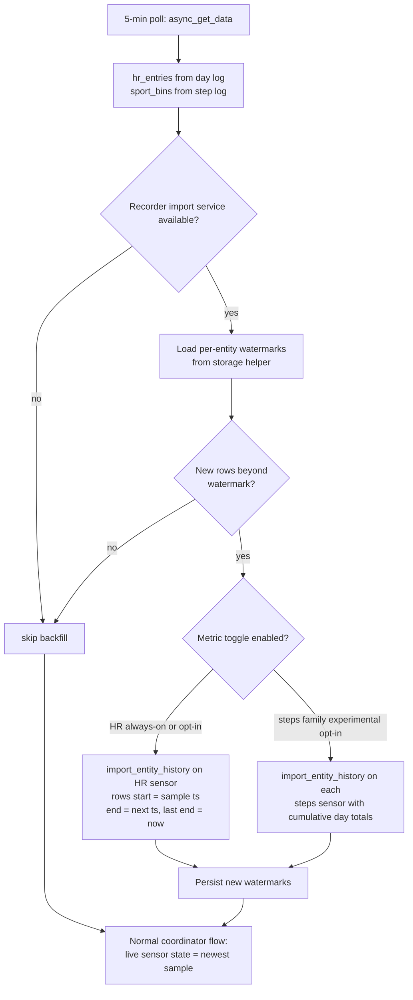

# Backfilling Off-Range Sensor Samples into HA History

## Problem

The ring logs data to its onboard memory even while out of BLE range. On reconnect,
[`api.py`](../custom_components/colmi_ring/api.py) already fetches/parses *entire* day
logs but keeps only the most recent values:

- **Heart rate**: full 288-slot/day (5-min grid) log is parsed via
  `HeartRateLog.heart_rates_with_times()`, then all but the newest non-zero sample are
  discarded → gaps in the history graph.
- **Steps/distance/calories**: full day of 15-min `SportDetail` bins is parsed, then
  only the day sums are kept.

HA cannot attach historical timestamps to state-machine events — states are always
recorded at write time. **But** the recorder offers
[`recorder.import_entity_history`](https://developers.home-assistant.io/docs/core/components/recorder),
the service HA's own restore flows use to insert historical `states` rows with arbitrary
past timestamps. This is the supported way to log "old" readings.

## Approach

Each poll, diff the ring's onboard logs against persisted *watermarks* (per entity: the
timestamp of the newest sample already imported) and import the delta into the recorder.

### Pieces

1. **`api.py`** — include the full day's time series in the data dict:
   - `"hr_entries": [(timestamp, bpm), ...]` (non-zero slots only, sorted). Trivial: the
     `entries` list is already computed.
   - `"sport_bins": [(timestamp, steps, distance, calories_kcal), ...]` from the
     `SportDetail` list already fetched every poll (calories scaled /1000 as today).
2. **`backfill.py` (new)** — generic per-entity `BackfillManager(hass, entry_id)`:
   - `homeassistant.helpers.storage.Store` (version 1, key `colmi_ring_backfill_{entry_id}`)
     holding per-entity watermarks
     `{"heart_rate": iso8601, "steps": iso, "distance": iso, "calories": iso}`; survives
     restarts so samples are never double-imported.
   - `async_sync(kind, rows)` called once per enabled metric each poll:
     - bail out if `hass.services.async_services()` lacks `recorder.import_entity_history`
       (recorder not loaded → no-op, debug log).
     - filter `ts > watermark`, drop the newest row (it flows through the live sensor),
       build `[{state, start, end, attributes}]` with `end` = next row's ts and the last
       row ending at `now` so the backlog stitches into the live trace.
       - **heart_rate** (`MEASUREMENT`): one row per non-zero slot, state = bpm.
       - **steps/distance/calories** (`TOTAL_INCREASING`): state = *cumulative day
         total* (running sum over the 15-min bins; calories scaled like the live
         sensor); emit a row only when the running total changes — zero bins
         implicitly extend the previous state.
     - resolve target entity id via
       `entity_registry.async_get(hass).async_get_entity_id("sensor", DOMAIN, <unique_id>)`.
     - `await hass.services.async_call("recorder", "import_entity_history", {...}, blocking=True)`
       under an `asyncio.Lock`.
     - persist watermark on success; log-and-continue on failure.
3. **`coordinator.py`** — call `await backfill.async_sync(...)` in `_async_update_data()`
   after assembling `data` (independent of the staleness/live-HR precedence logic: backlog
   import should happen even when the live sensor is currently stale/unknown).
4. **`__init__.py` / `data.py`** — construct the manager and hand it to the coordinator.
5. **Options flow (`config_flow.py`, `const.py`, translations)** —
   - `CONF_HR_BACKFILL` toggle, default **on** (safe for `MEASUREMENT` state class).
   - `CONF_STEPS_BACKFILL` experimental toggle covering steps + distance + calories,
     default **off**, labeled experimental with a warning that backfilled values
     populate the raw history graph but may not produce long-term statistics and can
     distort the `sum` line near junctions (see analysis below).

### Edge cases / notes

- **Overlap with live rows**: importing a window that overlaps already-recorded live
  states can draw overlapping segments. The watermark guarantees we only import *after*
  the last-imported sample; the tiny overlap with the in-flight live row is the same
  situation HA's own restore import produces and is tolerated by the frontend.
  Needs empirical check in the dev container (see spike step).
- **Zeros / off-finger**: HR zero slots are skipped → real gaps in the graph, which is
  truthful.
- **Clock drift**: historical slots were logged under the ring's clock at sample time;
  small offsets are inherent to the hardware (same as the existing latest-sample logic).
- **Restart**: watermarks in `.storage` → no duplicate imports; first-ever run imports
  the whole day, which is the desired "log the old readings" behavior.
- **Recorder absent / entity not yet registered / import error**: degrade silently.
- **`hr_live` on-demand readings** are not in the ring log; not backfilled (v1).

### Metric scope by data availability

| Metric | Onboard time series | Backfillable | State class | v1 |
|---|---|---|---|---|
| heart_rate | Yes, 5-min slots, already parsed | Yes | MEASUREMENT | Yes (default on) |
| steps / distance / calories | Yes, 15-min `SportDetail` bins, already fetched | Yes | TOTAL_INCREASING | Experimental opt-in |
| spo2 | No periodic log (on-demand real-time only) | No | — | No |
| battery / on-finger / settings | No time series | No | — | No |

### Why the steps family is experimental: `TOTAL_INCREASING` caveats

Backfilling `TOTAL_INCREASING` metrics hits two recorder-statistics behaviors:

1. **Statistics are never recomputed for old time ranges.** The periodic statistics
   engine only processes the trailing ~5-min window; buckets compact to medium-term
   (hourly) then long-term (daily) and become immutable. Imported `states` rows show
   up on the raw history graph but NOT in long-term statistics / the `sum` line.
2. **Reset heuristic at overlap junctions.** For `total_increasing`, *any* decrease
   between buckets is treated as a counter reset (delta silently zeroed). Where
   imported rows meet live-recorded rows (or a post-restart day-total reset), the sum
   line can be subtly distorted with no error.

`heart_rate` is a plain `MEASUREMENT`: neither issue applies, so its backfill is safe at
both layers. The experimental toggle's UI string should state the raw-history-only
expectation. If the spike shows unacceptable artifacts, the toggle can be removed
without touching the generic manager.

### Alternatives considered (rejected)

- **Fire custom events / attributes with old data**: events can't be backdated;
  attributes don't produce history graphs.
- **Integration-owned storage + custom frontend card/websocket command**: full control,
  but a much larger lift and loses the native history/statistics integration.
- **Dedicated history-only entity** (never live-updated, populated solely by imports):
  zero overlap risk with live rows, at the cost of a second sensor whose live state is
  meaningless. Fallback if the main-sensor approach proves glitchy in testing.

## TODO

- [ ] Return full-day `hr_entries` (ts, bpm) and `sport_bins` (ts, steps, distance, kcal) from `async_get_data()` in `api.py`
- [ ] Create `backfill.py`: generic `BackfillManager` with per-entity watermark `Store`, `async_sync(kind, rows)` calling `recorder.import_entity_history` (lock, service guard, dedup window); row builders for MEASUREMENT (HR) and cumulative TOTAL_INCREASING (steps family)
- [ ] Wire manager through `__init__.py`/`data.py` into `coordinator._async_update_data()` for HR always and steps family when enabled
- [ ] Add `CONF_HR_BACKFILL` (default on) and `CONF_STEPS_BACKFILL` (default off, experimental warning text) to the options flow + `const.py` keys + `en.json` strings
- [ ] Spike-verify in dev container: simulate an offline gap, confirm HR backlog renders at correct times on the history graph; with steps toggle on, check raw graph staircase and inspect the `sum` line / stats behavior near junctions; fall back to dedicated history-only entity design if unacceptable
- [ ] Stretch: multi-day backfill — walk previous days via `conn.get_heart_rate_log(target)` / `conn.get_steps(day_offset)` when watermarks are older than the current day
