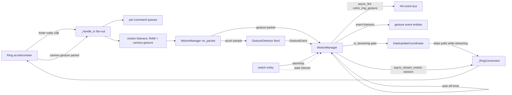

# Motion / gesture support for colmi_ring

Goal: read the ring's live accelerometer stream, detect **clap**, **rapid hand raise** and
**rapid hand lower**, and expose them as Home Assistant `event` entities. Streaming is
opt-in (a `switch`) because it holds the GATT link open and costs battery.

Protocol source: [`mrfloydst/smartringmidi bluetooth.html`](https://github.com/mrfloydst/smartringmidi/blob/main/bluetooth.html)
(user-provided), whose axis bit-shifting is itself lifted from
[`atc1441/ATC_RF03_Ring`](https://github.com/atc1441/ATC_RF03_Ring).

---

## Status: what is built

Phases 1-4 are implemented and validated offline; **Phase 0 was deliberately deferred** on the
user's instruction to implement against best guesses and correct the false ones later. Every guess
therefore sits in a named constant or a single documented assumption:

| Assumption | Where it lives | If wrong |
|---|---|---|
| RAW on = `A1 04 04`, off = `A1 02` | `colmi_codec/motion.py` | the switch never opens a stream |
| position packets are `packet[1] == 3` | `colmi_codec/motion.py` | no samples are ever decoded |
| 12-bit axes in wire order **Y, Z, X**, low bits in the **low** nibble of the next byte | `colmi_codec/motion.py::_axis` | rest magnitude is nowhere near 1 g |
| +/-4 g over 12 bits (`g = raw / 2048 * 4`) | `colmi_codec/motion.py` | every threshold is off by a constant factor |
| camera gesture `02 04` / `02 06` | `colmi_codec/motion.py`, used by `motion_manager` | claps come only from the stream |
| the stream's real sample rate | `MOTION_MIN_HZ_FOR_STREAM_CLAP` | the stream clap is wrongly enabled/disabled |
| which axis is vertical, and its sign | `gestures.py` (gravity-relative by construction) | raise and lower swap |

A pleasant consequence of projecting onto the *estimated gravity vector* instead of picking a
"vertical axis" by name: raise-vs-lower is correct for **any** axis mapping, since it only depends
on the sign of the component along gravity. Only the wire-order/nibble/scale guesses can break the
detector wholesale, and the probe will show that immediately (rest magnitude ~1 g or not).

---

## Decoded protocol

### Transport

Same UART service we already use ([`api.py`](../custom_components/colmi_ring/api.py) lines 53-55):
write to `6E400002-…`, notify from `6E400003-…`. The demo attaches its listener to *every*
notifiable characteristic of either the `de5bf728-…` (RF03) or `6E40fff0-…` (Colmi UART)
service, so on the R02 our existing TX notify subscription is the right place - no new
characteristic work.

### Enable / disable RAW mode

| Action | Bytes | Our equivalent |
|---|---|---|
| RAW data on | `A1 04 04 … A9` | `make_packet(0xA1, bytearray([4, 4]))` |
| RAW data off | `A1 02 … A3` | `make_packet(0xA1, bytearray([2]))` |

The demo builds the 16-byte frame as `arrayOut[15] = (sum of data bytes) & 0xFF`, which is
byte-for-byte what [`make_packet`](../custom_components/colmi_ring/colmi_codec/packet.py)
already does (byte 15 is zero when summed, so `sum(packet) & 255` is identical). **No new
framing code needed.**

### Accelerometer sample

Notifications are classified by **byte 1**; `byte[1] == 3` means position data. Each axis is
a **12-bit big-endian signed value split over two bytes** - high byte, then the low bits in
the *next* byte:

```js
rawY = int12(((value[2] << 4) | (value[3] & 0xf)) & 0xfff)
rawZ = int12(((value[4] << 4) | (value[5] & 0xf)) & 0xfff)
rawX = int12(((value[6] << 4) | (value[7] & 0xf)) & 0xfff)
int12(v) = v > 2047 ? v - 4096 : v
G        = (raw / 2048) * 4        // +/-4 g range
```

Notes for the decoder:
- **Axis order on the wire is Y, Z, X** - easy to get wrong, and it matters for
  raise-vs-lower sign.
- The low nibble is masked from the **low** nibble of the following byte (`& 0xf`). Copy it
  verbatim, but *confirm* with the Phase 0 probe whether the ring really parks the low bits
  there rather than in the high nibble (`>> 4`); if we read garbage that never sits near
  +/-1 g at rest, flip that assumption.
- Sanity check at rest: `|(Ax, Ay, Az)|` should be ~1.0 g. That single assertion validates
  offsets, scale and sign together, and is the acceptance test for Phase 1.

### Bonus: the ring already detects a clap on-device

From the demo's own text: *"Turn the ring's 'camera button' into a 'clap' trigger. The camera
gesture detection can be turned on by sending `0204` and turned off by sending `0206`."*
i.e. `cmd 0x02` with sub `0x04` / `0x06` (add a checksum byte as usual). This matters because
the stock firmware streams RAW data slowly (the demo notes a **custom firmware** is needed
to "speed up RAW data transmission intervals considerably"; its own interpolation loop runs
at 40 ms as an aspiration, not a measured rate). At a low native sample rate, deriving a
sub-120 ms clap impulse from the accel stream is unreliable - whereas the camera gesture is
detected **on the ring**, costs no continuous connection, and arrives as an event.

Both routes are therefore used **at the same time** (as built): a session arms the camera gesture and
runs the stream clap in parallel, labelling each event `source=ring` or `source=stream`, and the
measured rate decides only whether the stream route is kept. Which one ends up carrying clap is the
Phase 0 probe's to report, not to decide.

---

## Phase 0 - Probe the real ring ⏸ deferred (Phases 1-4 built ahead of it, deliberately)

The user chose to build against best guesses first and correct the false ones afterwards, so the
codec, transport, detector and HA surface all landed without a capture. The guesses and how each
one fails are tabulated under **Status** above. `scripts/_accel_probe.py` still needs updating to
the as-built packet names before it runs; its remaining unique value is the two things no
simulation can produce - the stream's real sample rate, and battery drain per streaming hour.

`scripts/_accel_probe.py` (dev-only, matching the existing `scripts/_*.py` convention):

1. Connect via local `bleak` to `78:14:12:A0:0F:8C`, subscribe to the TX char with a raw
   `hex() + monotonic timestamp` logger.
2. Record passively ~30 s (the ring may emit motion notifications unprompted).
3. Send `make_packet(0xA1, [4, 4])`; sample while the hand is (a) still, (b) raised,
   (c) lowered, (d) clapped; then send `make_packet(0xA1, [2])`.
4. Report: notification **rate** (Hz) - the number that decides the clap strategy; which
   byte offsets vary (per-byte variance isolates the axis fields); whether the rest
   magnitude is ~1 g with the `& 0xf` decode; the actual `byte[0]`/`byte[1]` values; and
   whether a camera/clap gesture packet appears after `02 04` (sweep `02 04` / `02 06` and
   log what arrives).

Deliverables: confirmed constants, decode function, measured Hz, and the clap source
(on-device gesture vs stream-derived).

## Phase 1 - Codec: `colmi_codec/motion.py` ✅ built

- `CMD_RAW_MODE = 0xA1`, `get_raw_start_packet()` / `get_raw_stop_packet()`.
- `CMD_GESTURE = 0x02`, `get_camera_gesture_on_packet()` / `..._off_packet()`; `Gesture` enum
  for what the ring reports (`parse_gesture_packet`).
- `TYPE_POSITION = 3`; `@dataclass(frozen=True, slots=True) AccelSample(x, y, z: float)` in
  **g**, plus `magnitude_g` and `gravity_vector()` so the detector never touches raw counts.
  No `pitch_roll()`: the detector compares two heading *vectors* by angle, which sidesteps the
  `atan2` quadrant and gimbal awkwardness of Euler angles entirely.
- `parse_accel_packet(packet) -> AccelSample | None` (named for what it returns, not for the
  stream) - returns `None` for a non-position packet or unexpected length instead of raising, so
  one stray frame cannot kill the stream (contrast:
  [`parse_real_time_reading`](../custom_components/colmi_ring/colmi_codec/real_time.py) asserts on
  the command byte, which would be fatal here).
- Validation is `scripts/_motion_replay.py` (see Phase 5) rather than a separate decode script:
  it replays either a synthetic stream or a captured one through this parser, so the ~1 g-at-rest
  and raise-sign assertions run against the same code path the integration uses.

## Phase 2 - Transport: fan-out listener + long-lived shared session ✅ built

[`_RingConnection._handle_tx`](../custom_components/colmi_ring/api.py) routes each packet to
a single per-command `asyncio.Queue` awaited by one `_command` call, and silently drops
packets whose `packet[0]` has no handler. That cannot represent an open-ended stream.

- `add_listener(cmd, cb)` / `remove_listener(...)` added; `_handle_tx` fans out to queues **and**
  listeners, preserving the existing length guard and `_command` timeout semantics.
- Internal `_motion_stream(on_packet)` async context manager owns one long-lived
  `_RingConnection`: connect, register listeners, send RAW-on, yield; on exit (every exit path,
  including an exception in the body) cancel the watchdog, unregister and send RAW-off. Listeners
  are registered for **both** `CMD_RAW_MODE` and `CMD_CAMERA_GESTURE`, so one session sees the
  samples and the ring's own gestures.
- Public `async_stream_motion(on_packet, should_run, on_session)` runs the session in a *loop*: it
  hands the fresh `MotionSession` to `on_session` (where the manager arms auto-off, the rate probe
  and the camera-gesture enable), awaits `session.wait_stopped()`, and reconnects after
  `_STREAM_RETRY_S = 10` s if the session died by itself (`disconnected` / `silent`) while
  `should_run()` is still true. A user-requested stop is final.
- `MotionSession` is how a stop is requested from outside the task: `request_stop(reason)` sets an
  `asyncio.Event` that the runner awaits, so `async_stop` needs no cancellation.
- Silence detection lives in the connection: the listener calls `_RingConnection.touch_motion()` on
  every packet, and `_watch_stream` (every `_STREAM_WATCHDOG_S = 5.0`) ends the session if the link
  `dead` flag is set or nothing arrived for `MOTION_STREAM_SILENCE_TIMEOUT_S = 30.0`.
- A stream that cannot be opened **returns** `None` instead of raising, so the switch lands on `off`
  with one warning line rather than an exception out of a service call.
- **Connection contention - DECIDED: pause polling.** The ring serves one central and today
  every poll opens its own connection ([`_RingConnection`](../custom_components/colmi_ring/api.py)
  connects and disconnects per call), so a long-lived stream and a poll cannot coexist. While a
  stream is live the coordinator performs **no** BLE I/O, and resumes the moment the stream
  closes.
- **How the pause is implemented**: gate the top of
  [`_async_update_data`](../custom_components/colmi_ring/coordinator.py) on
  `MotionManager.is_streaming` and return the cached `self.data` unchanged. Prefer this over
  `async_shutdown()` (which has no supported restart) - the refresh timer keeps firing, each
  tick just costs nothing, and `_apply_poll_interval` state survives untouched.
- **Side effects of pausing, all handled:**
  - Heart rate / steps / battery go **frozen, not `unavailable`**, because the coordinator keeps
    succeeding with cached data and
    [`_heart_rate_is_stale`](../custom_components/colmi_ring/coordinator.py) never runs. On
    stream *start*, push a cleared HR (`heart_rate = None`, `heart_rate_timestamp = None`) via
    `async_set_updated_data` so the sensor reads `unknown` rather than lying to automations; on
    stream *stop*, call `coordinator.async_refresh()` so it recovers immediately instead of on
    the next scheduled tick.
  - Backfill only runs from `_async_update_data`, so it pauses too - harmless, since the
    scanned-days design is idempotent and re-reads those days on the next successful poll.
  - Every other call site that opens a connection must refuse while streaming: the SpO2 and
    on-demand heart-rate **buttons** ([`button.py`](../custom_components/colmi_ring/button.py)),
    blink / reboot, and the HR-interval **number** write
    ([`number.py`](../custom_components/colmi_ring/number.py)). Raise
    `HomeAssistantError("Unavailable while the motion stream is on")` so the UI shows a clean
    failure instead of contending for the link.
  - Stream start/stop flips a flag on the coordinator **before** the connect/disconnect, so a
    poll already in flight finishes (its `finally` disconnects) rather than racing the stream.
- **Robustness**: as above, and the packet path is **callback-safe by construction** -
  `MotionManager._on_packet` never awaits, and every gesture listener is wrapped so a raising
  entity cannot break the stream or the other listeners. Unparsable notifications are logged at
  DEBUG with their hex (which is how a wrong decode assumption becomes visible) and dropped.
- `MotionManager.async_shutdown()` runs on unload/reload *before* the platforms unload, so a live
  stream is never left holding a connection nobody owns: it requests the stop, waits 10 s, and
  cancels only if the task refuses to finish.

## Phase 3 - Gesture detection: `gestures.py` (+ `motion_manager.py`)

*As built.* The detector is the HA-free [`gestures.py`](../custom_components/colmi_ring/gestures.py)
`GestureDetector`; [`motion_manager.py`](../custom_components/colmi_ring/motion_manager.py) owns the
session, feeds it packets and publishes what comes back. (`colmi_codec/motion.py` is the codec only -
the original plan put the detector there.)

Every threshold is a **best guess pending the Phase 0 probe**, and every guess is a named `MOTION_*`
constant in [`const.py`](../custom_components/colmi_ring/const.py), so the probe corrects them in one
place. The detector is **rebuilt per session**: the gravity reference and the rate estimate belong to
one continuous connection, not to the integration's uptime.

- **Gravity is a complementary filter of the raw vector.** A slow EMA
  (`MOTION_GRAVITY_TAU_S = 3.0`) so a gesture cannot tilt the reference frame, converging *fast*
  (`MOTION_GRAVITY_FAST_TAU_S = 0.08`) whenever `|a|` sits within `MOTION_GRAVITY_TRUST_G = 0.2` of
  1 g - a sample whose magnitude is ~1 g is by definition not accelerating, so it *is* the gravity
  direction. Without that fast path, a wrist that changes pose while the slow estimate still points
  the old way (a stream resuming after a gap, or dropped samples) reads as hundreds of ms of slow
  downward acceleration and fires a phantom `hand_lower`.
- **Raise / Lower - a movement state machine judged on its closing edge.** The gravity-projected
  linear acceleration feeds a leaky integrator (`MOTION_VELOCITY_LEAK_TAU_S = 0.45`); positive
  velocity is `hand_raise`, negative is `hand_lower`. A movement opens when `|v|` crosses the
  threshold and is judged only once `|v|` falls back under `threshold * 0.3`, so both the peak
  velocity and the total heading swing are known by then. It is accepted only if:
  - it reached its peak within `MOTION_RAISE_MAX_PEAK_S = 0.6` of the last moment the hand was
    still - a *rapid* movement is defined by its snap, not its total impulse (otherwise a steady
    two-second push eventually accumulates enough leaked velocity to qualify); and
  - the gravity direction swung by at least `MOTION_RAISE_PITCH_DEG = 15` degrees between the
    movement's open and close (`_swung_during`, headings averaged over
    `MOTION_PITCH_RECENT_WINDOW_S = 0.25`), so a straight up-and-down bounce cannot pass.
- **Clap - four independent tests on the raw `magnitude_g`,** because a vibration (shaking hand,
  mower, steering wheel) produces a machine-gun of individually well-shaped impulses:
  1. **Rise**: from `< 0.4 x MOTION_CLAP_SPIKE_G` to the spike within `MOTION_CLAP_RISE_S = 0.15`.
  2. **Width**: at most `MOTION_CLAP_MAX_WIDTH_S = 0.25` - a clench or a swung arm sustains
     acceleration for hundreds of ms; a clap impulse is tens of ms.
  3. **Prior stillness**: `MOTION_CLAP_QUIET_S = 0.4` of `|a|` within
     `MOTION_CLAP_QUIET_BAND_G = 0.15` of 1 g. Measured on the **raw magnitude**, never on the
     gravity-projected accel, which crosses zero twice per vibration cycle and so cannot say
     "this hand is moving".
  4. **Ring-down**: after the impulse the motion must fall to `MOTION_CLAP_RING_DOWN_FRACTION =
     0.25` of *the impulse's own peak* and stay there `MOTION_CLAP_SETTLE_S = 0.2`, reaching it
     within `MOTION_CLAP_RING_DOWN_S = 0.6`. This is the test that separates a clap from the first
     half-cycle of a shake (with prior stillness the two have near-identical shapes) - a clap is
     followed by a coasting hand, a shake by more shaking. Relative rather than absolute because
     the counter-stroke of a real clap is *part of* the clap; the deadline matters because a shake
     keeps interrupting the ring-down until its very last half-cycle settles and would then be
     awarded a gesture a beat after the shaking stopped. The candidate is held **pending** until it
     rings down, costing that much latency.
- **The ring's own clap is used too, not instead.** On session open the manager best-effort sends
  the camera-gesture enable (`02 04`; firmware that lacks it simply answers nothing) and reports any
  gesture packet as `source=ring`, after a `MOTION_STARTUP_MUTE_S = 2.0` mute, because the ring
  echoes our own enable packet back at us. The stream-derived clap (`source=stream`) is disabled by
  `MotionManager._async_check_rate` if the measured rate is under `MOTION_MIN_HZ_FOR_STREAM_CLAP =
  15`, with a single INFO line naming the measured Hz - raise/lower still work, and only the
  weakest-evidence detector is dropped.
- **Design rule: sensitivity scales magnitudes only.** `GESTURE_SENSITIVITY_SCALE`
  (`low 0.6 / medium 1.0 / high 1.6`) is a *divisor* on the base thresholds, so a bigger number is
  more sensitive. The shape tests (rise, width, ring-down) and the orientation swing are
  deliberately **not** scaled: relaxing them on "high" would delete the very discrimination
  automations rely on.
- **Cooldowns**: `MOTION_GESTURE_COOLDOWN_S = 1.2` between reports of the same gesture,
  `MOTION_CLAP_REFRACTORY_S = 0.6` between claps (two claps in a row are a deliberate double clap),
  and `MOTION_GESTURE_SUPPRESS_S = 0.5` of mutual suppression, since a hard raise also looks like a
  clap.
- **Tuning aid**: `GestureEvent.as_event_data()` carries `gesture`, `source`, `peak_g` and
  `velocity_g_s`, so the event log shows what a real gesture actually scored against these guesses.

## Phase 4 - Home Assistant surface ✅ built

- **[`event.py`](../custom_components/colmi_ring/event.py)** - three `EventEntity`s (`Clap`, `Hand
  Raise`, `Hand Lower`) whose entity event type *is* the gesture key, so each can be an automation
  trigger on its own and gets free `last_triggered` history in the UI. Unique ids
  `{entry_id}_gesture_{key}`; children of the ring device. **In addition**, `MotionManager._publish`
  fires the `colmi_ring_gesture` event directly on the bus with
  `{gesture, source, peak_g, velocity_g_s, entry_id}` - deliberately *not* from an entity, so it
  still arrives when the event entities are disabled, and one trigger catches all three gestures
  regardless of how the event integration names its generated events.
- **[`switch.py`](../custom_components/colmi_ring/switch.py)** - `sensor/switch.colmi_ring_motion_stream`.
  `is_on` reads `MotionManager.is_streaming`, and the entity subscribes to `add_state_listener`, so
  the switch always follows reality: a failed open, an auto-off, or a reload all settle it back to
  `off` instead of lying. `icon: mdi:motion-sensor`; deliberately **not**
  `entity_category=CONFIG` (it is an operational toggle automations may call). A connect failure is
  not raised from `async_turn_on` - the client returns, the manager clears the flag, and the log
  gets one warning.
- **Stream-state plumbing** - `MotionManager` is **always constructed** in
  [`__init__.py`](../custom_components/colmi_ring/__init__.py) next to `BackfillManager` and stored
  on `runtime_data` *and* on the coordinator, because the coordinator has to be able to ask whether
  the stream holds the link even in setups where the option is off. It does no I/O until asked.
  `async_start` flips `is_streaming` and calls `coordinator.async_clear_heart_rate()` *before*
  connecting, so no poll can race onto the link and a frozen heart rate can never look fresh; when
  the stream task returns, `async_notify_stream_finished()` clears the flag and requests a refresh.
- **Auto-off guard** - the `motion_stream_timeout` **option** (default 30 min, `0` = stay on until
  switched off), rearmed by `async_call_later` on session open and on *every gesture*, so an active
  user is never cut off mid-session. Turning the stream off from the UI cancels it.
- **Options flow** ([`config_flow.py`](../custom_components/colmi_ring/config_flow.py)) -
  `CONF_MOTION_ENABLED` (creates the switch and the event entities at all; default **off**),
  `gesture_sensitivity` select (labelled *Low (only clear movements)* / *Medium* / *High (also
  slight movements)*), `motion_stream_timeout` number (0-480 min), `motion_log_samples` boolean
  (DEBUG-log every decoded sample, for tuning against a real wrist). `translations/en.json` carries
  the option labels and help text, including a plain statement that normal polling stops while the
  stream is on.
- **Wiring** - `const.py` constants; `PLATFORMS` gains `Platform.SWITCH` and `Platform.EVENT` (both
  platforms return early when `CONF_MOTION_ENABLED` is off, so nothing appears in a normal setup);
  `MotionManager` owns client + detector + session + timers, while the coordinator remains the sole
  owner of connection lifetime for everything else. Every other connection-opening call site refuses
  with `STREAM_BUSY_MESSAGE` via `ColmiRingEntity._assert_ring_free()`.

## Phase 5 - Validation

### Offline ✅ (this is what built the detector)

`homeassistant` is not importable on the dev host, so the pure modules are exercised directly by
two dev-only scripts that stub the HA packages out of `sys.modules`:

- [`scripts/_motion_synth.py`](../scripts/_motion_synth.py) generates physically plausible streams
  and replays them: `--scenario gestures` (still, clap, snap raise, snap lower) and `--scenario
  negatives` (a sustained clench, a 9 Hz shake, a slow two-second lift, and a walking bounce -
  movements that must *not* fire). `--out FILE` also writes CSV.
- [`scripts/_motion_replay.py`](../scripts/_motion_replay.py) replays a CSV or a probe capture
  through the real `parse_accel_packet` + `GestureDetector`, prints the signal summary and the
  gesture timeline, and can plot the stream when matplotlib is available.

Measured, at sensitivities 0.6 / 1.0 / 1.6:

| Scenario | Result |
|---|---|
| `gestures` | exactly 3 events: `clap`, `hand_raise`, `hand_lower` (e.g. `clap @2.44 s peak=2.37 g`, `hand_raise @4.7 s v=+0.30 g*s`, `hand_lower @7.4 s v=-0.34 g*s`) |
| `negatives` | **0 events at all three sensitivities** |
| CSV round-trip | identical timelines through `_motion_replay.py`, so the codec path is covered too |

Tuning that only this harness found (each one a real false positive or false negative): the
complementary gravity filter, stillness measured on the raw magnitude instead of the projected
accel, ring-down measured relative to the impulse's own peak rather than absolutely, zeroing the
"preceded by stillness" timer on every moving sample, the ring-down deadline, and removing the
sensitivity scaling from the orientation test.

- Static: `python -m compileall -q custom_components\colmi_ring`; `python -m ruff check
  custom_components\colmi_ring scripts\_motion_replay.py scripts\_motion_synth.py --select
  F,E9,B,PLR --ignore PLR2004` (repo baseline - `RUF` is *not* part of it, and adding it surfaces 26
  pre-existing findings).

### On-device ⏳ (needs the ring)

- Gestures fire with acceptable latency; the HR sensor reads `unknown` (not a stale value) while
  streaming and recovers within a second of the switch turning off.
- The SpO2/HR buttons, blink/reboot and the interval number fail with `STREAM_BUSY_MESSAGE` during
  a session.
- Walking out of range ends the session with a one-line warning and an `off` switch; the reconnect
  loop retries while the switch is still on; auto-off fires.
- The rate probe reports the measured Hz *and* the median at-rest magnitude, confirming or replacing
  `MOTION_MIN_HZ_FOR_STREAM_CLAP` and the +/-4 g scale; **measure and record battery drain per
  streaming hour here**.
- Confirm the post-stream poll re-imports nothing twice (the scanned-days set is idempotent).
- Then fix/extend `scripts/_accel_probe.py` and correct whatever it disproves, in `const.py` and in
  the **Status** table above.

## Risks

| Risk | Mitigation |
|---|---|
| Stock firmware streams too slowly for a stream-derived clap | rate probe disables *only* the stream clap and says so once; the on-device camera gesture (`02 04`) is armed in parallel, and raise/lower work at any rate |
| Low-nibble decode assumption is wrong | rest magnitude will be nowhere near 1 g, which the replay script shows immediately; unparsable/odd packets are logged with hex |
| Axis order / sign misread (wire order is Y, Z, X) | largely moot: velocity is projected onto the *estimated gravity vector*, so raise/lower are correct for any axis mapping; only scale/nibble can break it wholesale |
| Ring will not serve commands while streaming | **decided:** coordinator pauses polling for the session; HR reads `unknown`, other call sites refuse with `STREAM_BUSY_MESSAGE` |
| Frozen HR looks like working data while streaming | stream start clears `heart_rate` before connecting, so the sensor goes `unknown`; stream end triggers an immediate refresh |
| Continuous streaming drains battery | opt-in option (default off) *and* opt-in switch, auto-off rearmed per gesture, stream stops on unload/reload |
| False positives from walking, typing or a vibrating hand | the four clap tests (rise / width / prior stillness / ring-down) and the two movement tests (peak timing / orientation swing), all validated against a scripted must-not-fire scenario |
| Detection logic is tuned against simulation, not the real ring | every threshold is a named `MOTION_*` constant; `peak_g`/`velocity_g_s` ride along in the event data so real gestures can be compared to the guesses |
| A wrong guess makes the feature silently useless rather than broken | the Status table lists how each assumption fails, and each failure mode is visible in the log (`unknown stream packet`, the rate line, the gesture debug line) |

## Data flow


