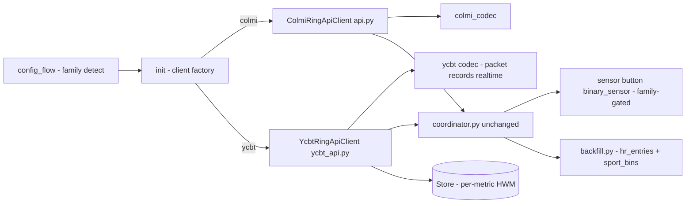

# Yucheng YCBT Ring Support — Implementation Plan

Goal: let `colmi_ring` pair with Yucheng YCBT-family rings (R20 / R11M firmware 2.32 are the reference models for this protocol family; target device here is an **R99** — same firmware family, same OEM app ecosystem, protocol model-unverified until probed) alongside existing Colmi rings, sharing the coordinator, entities, and backfill machinery.

## Target device: R99 6B81 observations

- Advertises `0x180D` (standard Heart Rate Service — matches the R20's `0x2A37` live-HR path) and `0xFEE7` (16-bit serial-service alias; **not** the `be940000` UUID). Whether `be940000/0001/0003` appear in the full GATT table must be confirmed by connection (Phase 0 probe).
- Name `R99 6B81` follows the family naming convention (R20/R39/R40/R50/R99/...); a `^(R20|R11M)$` allowlist would be a tested-model list, not a protocol limit.
- Manufacturer data (company `0x7830`) embeds a battery-like byte (`0x64` = 100) and the device MAC — a potential no-connection battery read and a stable detection signal.

Protocol source of truth: HCI snoops of the official companion app, cross-checked against the public YCBT SDK (`com.yucheng.ycbtsdk`). Record layouts are verified by `scripts/_ycbt_codec_selftest.py`.

## Protocol summary (reverse-engineered from app traffic)

### Transport
- GATT service `be940000-7333-be46-b7ae-689e71722bd5`
  - `be940001-…` write-without-response + **indicate** (commands + most replies)
  - `be940003-…` **notify-only** (unsolicited push frames)
- Also subscribe the standard Heart Rate Service `0x2A37` (1 Hz live HR with sensor-contact flag).
- Writes **must** be `WRITE_TYPE_NO_RESPONSE` (firmware is sensitive to it).

### Frame
```
[group][key][len_lo][len_hi][payload…][crc_lo][crc_hi]     len = payload + 6
opcode = (group << 8) | key;  length LE;  CRC LE at tail
```
CRC-16 custom Yucheng variant, seed `0xFFFF` (verbatim port from `R20Packet.crc16`).
Malformed/short frames (< 6 bytes or len mismatch) are dropped silently.

### Timestamps
uint32 LE = seconds since **2000-01-01 UTC** (`+946684800`), but stored as *wall-clock-local-as-UTC* → `unix_ms = (ts2k + 946684800) * 1000 − tz_offset(ring)`. Ring TZ assumed = HA server TZ (option later if needed). Set-time `0x0100` payload: `[year_lo, year_hi, month, day, h, m, s, dow]` with dow Mon=0..Sun=6, local wall-clock fields.

### Key opcodes
| Purpose | Opcode | Notes |
|---|---|---|
| set time | `0x0100` | must precede history reads |
| enable health sensors | `0x0104` | 1 byte; **required** or PPG never fires |
| set monitor interval | `0x010C` | `[enable, minutes]`; HR monitor (firmware ignores <30 min) |
| bg BP / temp / SpO2 monitors | `0x011C` / `0x0120` / `0x0126` | same `[enable, minutes]` payload; drive autonomous sampling |
| get device info (fw) | `0x0200` | reply magic `'GC'`; fw = `byte3.byte2` |
| get device name | `0x0203` | magic `'GP'` |
| get now step | `0x020C` | empty payload; steps = u32 LE @5 |
| battery | `0x0225` | empty payload; percent = payload[28] |
| prime sensors | `0x030C` | `[0x01, 0x01]` before live measurement |
| start/stop measurement | `0x032F` | `[action(1/0), type]`; types 0=HR 1=BP 2=SpO2 |
| measurement complete | `0x040E` | push |
| history requests | `0x0502` sport, `0x0504` sleep, `0x0506` HR, `0x0508` BP, `0x0509` all, `0x052D` sport-mode | → streams `0x0511/0x0513/0x0515/0x0517/0x0518/0x052E?` |
| history ack ("next page") | `0x0580` | `[stream_hi, stream_lo, len_lo, len_hi]` |
| live pushes | `0x0601` HR bpm, `0x0602` SpO2 %, `0x0603` BP sys/dia/hr, `0x0615` battery, `0x0600` snapshot | payload[0] mostly |

`Get*` commands need 2-byte magic prefixes (`'GC'/'GF'/'GP'/'IS'`) or firmware replies `0xFE`. `0xFC` single-byte payload = refusal → one stale-bond recovery burst (time + sensors + interval + bg-SpO2 + info) per session.

### History record layouts (LE)
- **HR** 6 B: ts4, rsv, bpm (keep 0<bpm<240)
- **BP** 8 B: ts4, valid, sys, dia, hr
- **Sleep**: 20 B header (len u16@2, startTs@4, endTs@8, sentinel u16@12 =0xFFFF→none, deepCount, lightCount, deepMin, lightMin) + 8 B stages `[type, ts4, dur3]`; types 241 deep / 242 light / 243 REM / 244 awake
- **AllRecord** 20 B: ts4, steps u16@4, hr@6, sys@7, dia@8, spo2@9, rr@10, hrv@11, cvrr@12, temp int@13 + 0.01°frac@14, bodyfat int@15 +frac@16, bloodsugar@17, pad2
- **Sport** 14 B: startTs4, endTs4, steps u16, dist m u16, kcal u16
- **SportMode** 25 B: start u32, end u32, steps u32, dist u16, kcal u16, mode, startMethod, avgHr, activeSec u32, minHr, maxHr (not yet live-verified upstream — golden tests only; keep behind a flag / tolerate absence)

### Sync policy (ported from R20DeviceSupport)
Read-only ring (never send `0x054x` deletes) + per-metric **high-water marks** persisted in a HA `Store`. **ACK a stream block only when it carried records newer than the HWM**; ACKing already-seen blocks = infinite loop (cursor never advances). Drop future-dated HWMs > 5 min ahead. Range-filter all metrics before persisting.

## Existing architecture to reuse

- [`coordinator.py`](custom_components/colmi_ring/coordinator.py:34) — device-agnostic: live HR/SpO2 overlays, staleness, adaptive interval, BusyError handling. Reuse nearly unchanged (skip `_apply_poll_interval`'s ring-interval source for YCBT; fall back to `CONF_POLL_MAX_INTERVAL`).
- [`api.py`](custom_components/colmi_ring/api.py:142) `_RingConnection` pattern — HA BT stack resolution + `establish_connection`, single-link `asyncio.Lock` with purpose budgets, handler/queue dispatch. YCBT needs a variant: two subscribed characteristics, variable-length frames, 16-bit opcode keys, and a "collect pushes until silence" primitive instead of one-cmd-one-reply.
- [`backfill.py`](custom_components/colmi_ring/backfill.py:1) — watermark-diffed recorder import driven by `hr_entries` / `sport_bins` in the data dict. YCBT client emits the same shapes → backfill works unmodified.
- `sensor.py` / `button.py` / `binary_sensor.py` entity lists — gate per family.

## Capability mapping

| colmi_ring feature | YCBT equivalent | Decision |
|---|---|---|
| heart_rate + timestamp | history `0x0515`/`0x0518` + live `0x0601`/`0x2A37` | same keys |
| battery_level | `0x0225` payload[28] | same key |
| battery_charging (binary sensor) | no verified charging field | **omit for YCBT** (family-gate) |
| steps / distance / calories | `0x020C` now-steps + Sport history bins | same keys; steps = day-total from sport bins ∪ now-steps max |
| spo2 (+timestamp) | bg-sampled via `0x0517`/`0x0518` + live `0x0602` | same keys |
| hr_entries / sport_bins backfill | HR/Sport/AllRecord history | same dict shapes → [`backfill.py`](custom_components/colmi_ring/backfill.py:1) reused |
| hr_settings (interval number entity) | only write-side `0x010C` monitor interval, no readback | **number entity maps to `0x010C`** for YCBT (write-only, no verify read) |
| Read HR / Read SpO2 buttons | `0x032F` start + prime, 30 s auto-stop, median of pushes | reuse buttons |
| Blink / Reboot buttons | no equivalent opcode | **hide for YCBT** |
| Motion / gestures / wave / accel sensors | no equivalent | **hide for YCBT** (family-gate `CONF_MOTION_ENABLED` path) |
| — | BP (from `0x0517`/`0x0603`), sleep stages (from `0x0513`), temperature/HRV/resp (from `0x0518`) | **deferred — no new entity types in this project** (per review). Drain set is HR + AllRecord only; BP/sleep frames are tolerated and ignored |

## Design decisions

1. **Family abstraction = client polymorphism + config flag**, not a transport refactor. `CONF_DEVICE_FAMILY: "colmi" | "ycbt"` stored in `entry.data`; `__init__.py` picks `ColmiRingApiClient` vs `YcbtRingApiClient` behind one protocol-compatible surface (`async_get_data`, `async_take_heart_rate`, `async_take_spo2`, battery, settings, buttons). Existing entries default to `"colmi"` on migration v2→v3.
2. **New subpackage `colmi_codec/ycbt/`** mirrors the existing codec style: `constants.py`, `packet.py` (encode/decode/crc16), `records.py` (history parsers), `realtime.py`, `time_utils.py` (ts2k).
3. **`ycbt_api.py`** owns a `_YcbtConnection` (own copy of the connect/lock lifecycle adapted for two characteristics + opcode-keyed dispatch; a shared base class is explicitly *not* worth the churn to working Colmi code). One poll session = connect → subscribe 0001+0003 (+0x2A37) → init burst (time, interval, bg-SpO2, sensors) → battery/steps/info → sequential history drain per stream type (request, collect frames until ~1.5 s silence, ACK iff new) → return data dict.
4. **HWM persistence**: `Store("colmi_ring_ycbt_hwm_<entry_id>", 1)` with `{metric: iso_ts}`; identical semantics to GB prefs (including 5-min future-skew reset).
5. **Discovery/family detection** in `config_flow.async_step_bluetooth`: Colmi is positively identified (advertised `6E40FFF0-…` service or Colmi name pattern → colmi). YCBT family matches on *any* of: advertised `be940000-…`; `0x180D`+`0xFEE7` combo (the R99 pattern); name regex `^R\d{2,3}([ _-].*)?$` with Yucheng-style manufacturer data (company `0x7830`, MAC embedded in adv); otherwise unknown → family picker (radio) in the user step. Detection is a *hint only*: the authoritative check happens in `_test_credentials`, which connects and verifies the GATT table (`be940001`/`be940003` present, or `0xFEE7`-alias chars) plus a live `0x0200`/`0x0203` magic-prefix probe replying non-`0xFE` before committing the entry to family `ycbt`.

## Architecture diagram



## Phases

- **Phase 0 — R99 probe (de-risk)**: `scripts/_ycbt_probe.py` (joins the existing `_ring_scan`/`_ble_connect` script family) against `07:35:00:04:6B:81`: enumerate the full GATT table (is `be940000/0001/0003` present, or is `0xFEE7` the vendor service with its own char UUIDs?); subscribe everything; send the init burst + `0x0200`/`0x0203`/`0x0225`/`0x020C`; hexdump every frame with the codec's decode applied (frame/CRC pass rate = wire-format confirmation); run one HR + AllRecord drain. Output feeds Phase 1's golden fixtures and confirms/corrects any R99 opcode or service deltas vs R20 before integration code exists.
- **Phase 1 — codec + skeleton parity**: ycbt codec package with golden unit fixtures (CRC vectors + real frames captured in Phase 0, one fixture per record parser); family plumbing (const, config flow, migration, client factory); `YcbtRingApiClient.async_get_data` happy-path (init burst, battery, now-steps, HR + AllRecord drain with HWM); parity data dict → existing sensors + backfill light up with zero sensor.py changes.
- **Phase 2 — measurements**: live HR/SpO2 buttons (`0x030C`+`0x032F`, median-of-pushes, 30 s cap, `0x040E` completion); `0x010C` number-entity remap; `0xFC` recovery; 0x2A37 live-HR overlay. **No new entity types** (per review: BP sys/dia and sleep-session sensors deferred) — unsolicited BP/sleep/sport-mode frames are decoded far enough to be tolerated and ignored.
- **Phase 3 — polish**: Sport bins (`0x0502`→`0x0511`) → `sport_bins` + distance/calories day totals (existing sensors, no new entity types); error surface (BusyError parity for motion-manager-free family); translations/README/docs; SportMode (`0x052D`) stays out until live-verified.

## Risks / open questions

- **R99 ≠ R20**: protocol is firmware-family-level, not model-level, but unverified on this unit. If Phase 0 shows the vendor service is `0xFEE7` with different char UUIDs, the codec stays but `constants.py` gains a per-device GATT table; if opcodes differ (some Yucheng variants differ on live-measurement opcodes), the probe capture defines the corrected table. Worst case the R99 is a different SDK entirely and detection must reject it cleanly.
- `0x0615` battery *push* and `0x0600` snapshot layouts are only partly pinned upstream → treat as bonus (re-parse percent at payload[28], ignore otherwise); the R99's adv-embedded battery byte is a second bonus source.
- Stream end detection is timing-based (silence timeout) — needs generous `STREAM`-class lock budget (~90 s) like Colmi motion sessions.
- SportMode `0x052D` stream opcode not live-verified → out of scope this project.
- Two companion apps (OEM SmartHealth app + HA) can fight over the ring's single central; document "unpair from OEM app".

## TODO

- [ ] **Phase 0**: write `scripts/_ycbt_probe.py` — GATT enumeration + subscribe + init burst + info/battery/steps commands + one HR/All drain, hexdump + codec decode of every frame; run against R99 `07:35:00:04:6B:81` and record findings (service/char UUIDs, reply opcodes, CRC pass rate) back into this plan
- [ ] Create `colmi_codec/ycbt/` package: `constants.py`, `packet.py` (crc16 + encode/decode), `time_utils.py`, `records.py`, `realtime.py` + golden fixture tests (seeded from Phase 0 captures)
- [ ] Add `CONF_DEVICE_FAMILY` + YCBT constants to `const.py`; entry migration v2→v3 defaulting existing entries to `colmi`
- [ ] Family detection in `config_flow` (Colmi positive-ID; ycbt hints: `be940000`, `180d`+`fee7` combo, `R\d{2,3}` name + `0x7830` mfg data; else picker) + connect-time protocol verification in `_test_credentials`
- [ ] Implement `ycbt_api.py`: `_YcbtConnection` (two chars, opcode dispatch, collect-until-silence) + `YcbtRingApiClient.async_get_data` (init burst, battery, steps, HR + AllRecord drain with HWM Store + conditional ACK + 0xFC recovery; BP/sleep/sport-mode frames tolerated and ignored)
- [ ] Client factory in `__init__.py`; coordinator guards for missing hr_settings (poll interval fallback)
- [ ] Live measurements: `async_take_heart_rate` / `async_take_spo2` via prime+start+collect+stop; optional 0x2A37 overlay
- [ ] Family-gate entity platforms: hide motion/accel/blink/reboot/charging for ycbt; remap HR-interval number to `0x010C` (no new entity types — BP/sleep sensors deferred)
- [ ] Map HR history + Sport bins (phase 3) into `hr_entries`/`sport_bins` dict shapes → verify backfill import
- [ ] Docs: README support matrix, OEM-app conflict warning
